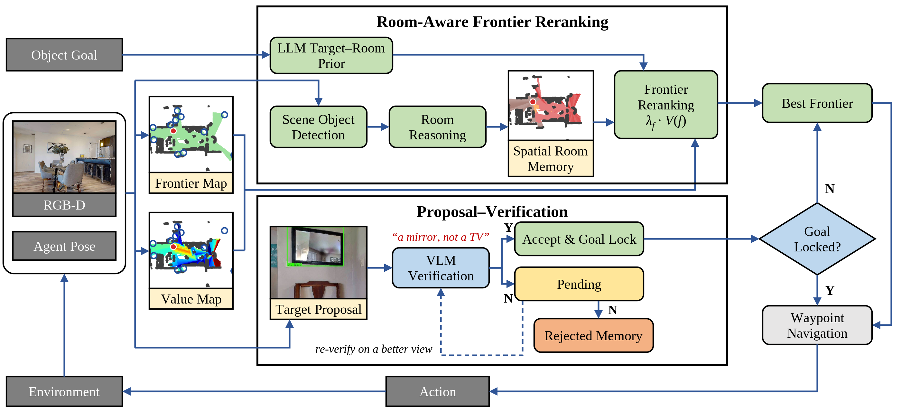

<h1 align="center">RoomVerify-Nav</h1>
<h3 align="center">Room-Aware Frontier Reranking and Proposal–Verification for Zero-Shot Object Navigation</h3>
<p align="center">
  Hongfei Yan, Xiangyi Zhu, Yanchao Lin, and Guorui Sheng<br>
  Ludong University
</p>

## Overview

RoomVerify-Nav is a training-free framework for finding objects in unseen indoor environments. It adds room-aware frontier reranking and detection verification to a navigation pipeline built around depth-based mapping, image-text similarity, and a PointNav planner.

The agent accumulates room distributions inferred from scene objects in a spatial memory. It uses target-room compatibility to rerank candidate frontiers with a bounded weighting factor. When a detector proposes a target, a vision-language model checks a box-annotated image. The agent remembers accepted and rejected instances to avoid repeated checks and keep its navigation goal.

<p align="center"></p>

## Installation

Use Linux, an NVIDIA GPU, Conda, Git, and tmux. The development environment uses Python 3.9, PyTorch 2.0.0, CUDA 11.8, and Habitat-Sim 0.2.4. GroundingDINO requires a compatible CUDA toolkit and compiler to build its extension.

### Create the environment

```bash
git clone https://github.com/NormanMises/RoomVerify-Nav.git
cd RoomVerify-Nav

conda create -n roomverify-nav python=3.9 -y
conda activate roomverify-nav
conda install -c conda-forge -c aihabitat habitat-sim=0.2.4 headless -y

pip install torch==2.0.0 torchvision==0.15.1 --index-url https://download.pytorch.org/whl/cu118
pip install -e .
pip install habitat-lab==0.2.420230405 habitat-baselines==0.2.420230405
```

### Install the detectors

Clone both detector repositories inside this repository:

```bash
git clone https://github.com/IDEA-Research/GroundingDINO.git
pip install --no-build-isolation -e ./GroundingDINO

git clone https://github.com/WongKinYiu/yolov7.git
```

## Download the datasets

### HM3D

Obtain access to the HM3D scene assets through the [official dataset instructions](https://aihabitat.org/datasets/hm3d/). Set your Matterport credentials in the current shell:

```bash
MATTERPORT_TOKEN_ID=your-token-id
MATTERPORT_TOKEN_SECRET=your-token-secret
DATA_DIR="$PWD/data"
```

Download the validation scenes used for evaluation:

```bash
python -m habitat_sim.utils.datasets_download \
  --username "$MATTERPORT_TOKEN_ID" \
  --password "$MATTERPORT_TOKEN_SECRET" \
  --uids hm3d_val_v0.2 \
  --data-path "$DATA_DIR"
```

Download and extract the HM3D ObjectNav episodes:

```bash
mkdir -p data/datasets/objectnav/hm3d
curl -L https://dl.fbaipublicfiles.com/habitat/data/datasets/objectnav/hm3d/v1/objectnav_hm3d_v1.zip \
  -o data/objectnav_hm3d_v1.zip
unzip data/objectnav_hm3d_v1.zip -d data/datasets/objectnav/hm3d
mv data/datasets/objectnav/hm3d/objectnav_hm3d_v1 data/datasets/objectnav/hm3d/v1
```

### MP3D

Follow the [Habitat dataset instructions](https://github.com/facebookresearch/habitat-lab/blob/main/DATASETS.md) to obtain MP3D scenes and ObjectNav episodes. Place the validation episodes at `data/datasets/objectnav/mp3d/v1/val/val.json.gz`. Keep each episode's scene path valid under `data/scene_datasets/`.

The expected episode layout is:

```text
data/
├── datasets/objectnav/
│   ├── hm3d/v1/val/val.json.gz
│   ├── hm3d/v1/val/content/*.json.gz
│   ├── mp3d/v1/val/val.json.gz
│   └── mp3d/v1/val/content/*.json.gz
└── scene_datasets/
    └── ...
```

## Download the model weights

Save these checkpoints in `data/`:

| Checkpoint | Download source |
| --- | --- |
| `mobile_sam.pt` | [MobileSAM](https://github.com/ChaoningZhang/MobileSAM) |
| `groundingdino_swint_ogc.pth` | [GroundingDINO](https://github.com/IDEA-Research/GroundingDINO) |
| `yolov7-e6e.pt` | [YOLOv7](https://github.com/WongKinYiu/yolov7) |
| `pointnav_weights.pth` | [PointNav checkpoint](https://github.com/rai-opensource/vlfm/blob/main/data/pointnav_weights.pth) |

BLIP-2 and tokenizer assets may download on first launch. Datasets and model weights are not included in this repository and retain their own terms.

Generate the placeholder checkpoint required by Habitat's evaluation runner:

```bash
mkdir -p data
python -m roomverify_nav.utils.generate_dummy_policy
```

## Configure the model API

```bash
cp .env.example .env
```

Edit `.env` with your API key and deployment endpoint. The latest recorded experiments, on October 18, 2026, used these settings:

| Setting | Value |
| --- | --- |
| Text model | `qwen3.8-flash` |
| Vision model | `qwen3.8-flash` |
| Temperature | `0.0` |
| Thinking | Enabled |
| Target-room prior reasoning effort | `medium` |
| Verification reasoning effort | `low` |
| Room inference reasoning effort | `low` |

The examples in `.env.example` use these values. Replace the placeholder endpoint with your own Alibaba Cloud Model Studio deployment URL. The client requires chat completions, JSON responses, image inputs, and support for the `enable_thinking`, `thinking`, and configured reasoning fields. Keep API credentials in `.env` and do not commit them.

## Evaluation within Habitat

### Start the model servers

```bash
./scripts/launch_vlm_servers.sh
```

The script starts four Flask servers in a detached tmux session. Wait for all models to load before starting evaluation. Inspect their output with:

```bash
tmux attach -t vlm-servers-12181
```

Detach with `Ctrl-b`, then `d`. The default ports are 12181 for GroundingDINO, 12182 for BLIP-2 ITM, 12183 for SAM, and 12184 for YOLOv7.

### Run on HM3D

Enable room-aware reranking and proposal verification:

```bash
PROMPTING_FRONTIER_RERANK=1 \
FIRST_DETECTION_VERIFY_ENABLED=1 \
./scripts/test_vlfm.sh
```

This evaluates the full validation split. Add `TEST_NUM_EPISODES=5` for a short run. To select one episode, add `TEST_EPISODE_IDS=33 TEST_NUM_EPISODES=1`.

### Run on MP3D

```bash
VLFM_DATASET=mp3d \
PROMPTING_FRONTIER_RERANK=1 \
FIRST_DETECTION_VERIFY_ENABLED=1 \
./scripts/test_vlfm.sh
```

Both feature switches default to off. Proposal verification defaults to the `toilet,tv,chair` categories; set `FIRST_DETECTION_VERIFY_CATEGORIES=''` to verify all target categories.

`scripts/test_vlfm.sh` lists runtime switches. The policy and detection thresholds are in `config/experiments/vlfm_objectnav_hm3d.yaml`; model API settings belong in `.env`.

Evaluation outputs go under `video/`, and Hydra outputs go under `outputs/`. To export videos, set `habitat_baselines.eval.video_option: ["disk"]` in the experiment YAML.

Stop the model servers when finished to release GPU memory:

```bash
tmux kill-session -t vlm-servers-12181
```

## License

The project uses the [MIT License](LICENSE) and retains existing copyright and license notices. External dependencies and pretrained models retain their own licenses; see [third-party notes](docs/third_party.md).

## Acknowledgments

We thank the authors of [VLFM](https://github.com/rai-opensource/vlfm) for the open-source implementation on which this project is based.
